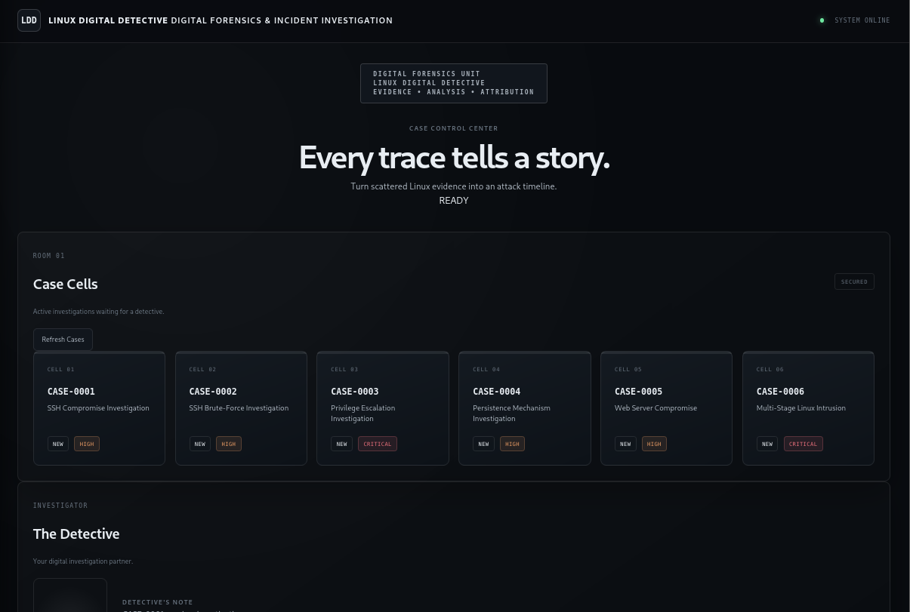
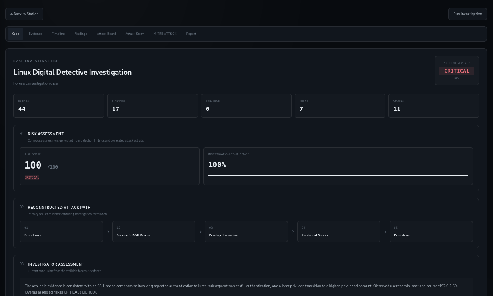
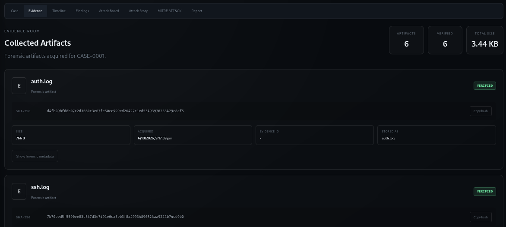
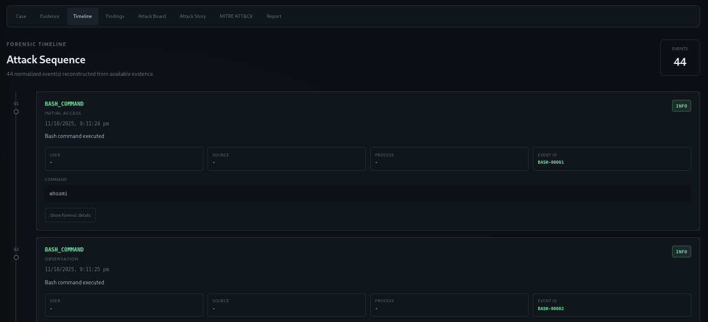
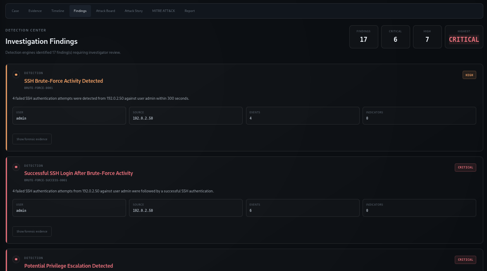
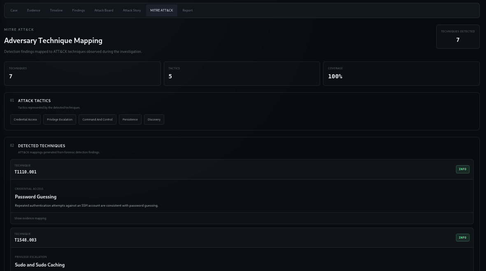
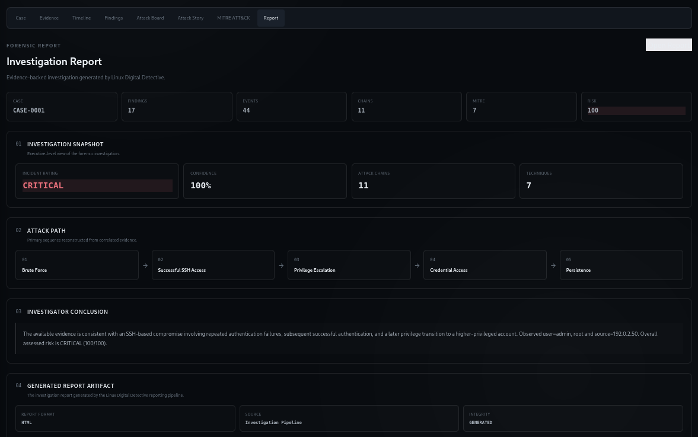

# 🕵️ Linux Digital Detective

### A Linux DFIR platform for turning raw host evidence into an investigation story.

<p align="center">
  <strong>Collect → Verify → Parse → Detect → Correlate → Investigate → Report</strong>
</p>

<p align="center">
  <a href="#-overview">Overview</a> •
  <a href="#-features">Features</a> •
  <a href="#-architecture">Architecture</a> •
  <a href="#-investigation-workflow">Workflow</a> •
  <a href="#-dashboard">Dashboard</a> •
  <a href="#-quick-start">Quick Start</a> •
  <a href="#-testing">Testing</a>
</p>

<p align="center">
  
  
  
  
  
</p>

---

## 📌 Overview

**Linux Digital Detective (LDD)** is a Linux-focused **Digital Forensics and Incident Response (DFIR)** platform built to investigate security incidents from host-based evidence.

Instead of examining individual log entries in isolation, LDD transforms scattered Linux artifacts into a structured investigation:

```text
Raw Evidence
     │
     ▼
Evidence Integrity
     │
     ▼
Artifact Parsing
     │
     ▼
Event Normalization
     │
     ▼
Detection
     │
     ▼
Event Correlation
     │
     ▼
Attack-Chain Reconstruction
     │
     ├──────────────┬──────────────┐
     ▼              ▼              ▼
 Risk Scoring   MITRE ATT&CK   Investigation
                               Story
     │              │              │
     └──────────────┴──────────────┘
                    │
                    ▼
             Analyst Dashboard
                    │
                    ▼
              Investigation Report
```

The goal is simple:

> **Turn fragmented Linux evidence into an explainable security investigation.**

---

# 🖥️ Dashboard Preview

The project includes an interactive Flask-based DFIR dashboard designed around a case-investigation workflow.

### Investigation Dashboard

<p align="center">
  
</p>

### Case Investigation

<p align="center">
  
</p>

### Evidence Analysis

<p align="center">
  
</p>

### Timeline Analysis

<p align="center">
  
</p>

### Findings

<p align="center">
  
</p>

### MITRE ATT&CK Mapping

<p align="center">
  
</p>

### Investigation Report

<p align="center">
  
</p>

---

# 🎯 Why I Built This

Traditional log analysis can become difficult when an incident generates activity across multiple sources.

For example:

```text
SSH failures
     ↓
Successful authentication
     ↓
Privilege transition
     ↓
Suspicious commands
     ↓
Persistence
     ↓
Network activity
```

An analyst needs to determine:

* What happened?
* When did it happen?
* Which events are related?
* How did the attacker progress?
* What evidence supports the conclusion?
* How severe is the incident?
* Which MITRE ATT&CK techniques are involved?

Linux Digital Detective was built to automate and visualize this investigation process.

---

# ⚡ Features

## 🔐 Evidence Integrity

* Evidence registration
* SHA-256 hashing
* Evidence manifests
* Integrity verification
* Evidence metadata
* Case-based evidence storage
* Original evidence preservation

---

## 📜 Linux Artifact Parsing

Current parsers support:

* Authentication logs
* SSH logs
* `sudo` logs
* Syslog
* Bash history
* Web access logs

The parser layer converts different artifact formats into normalized investigation events.

---

## 🚨 Detection Engine

LDD currently detects several common Linux intrusion behaviors.

### SSH Brute Force

Identifies repeated authentication failures grouped by relevant context such as:

* Source IP
* Username
* Time window

### Successful Login After Brute Force

Correlates successful authentication with preceding brute-force activity.

### Privilege Escalation

Identifies suspicious privilege transitions and elevated execution activity.

### Suspicious Commands

Detects command patterns associated with:

* Shell execution
* Downloads
* Reverse-shell behavior
* Base64 activity
* Credential access
* Network reconnaissance

### Network Activity

Identifies suspicious network-related behavior such as:

* Port scanning
* Network discovery
* Connection enumeration
* Network tooling
* Remote downloads

### Persistence

Detects persistence-related activity involving mechanisms such as:

* SSH authorized keys
* Cron
* Systemd
* Shell profiles
* Startup configuration

---

# 🧠 Investigation Engine

The investigation pipeline goes beyond individual detections.

Events are:

1. Parsed
2. Normalized
3. Ordered chronologically
4. Correlated
5. Grouped into attack chains
6. Assigned risk factors
7. Mapped to MITRE ATT&CK
8. Converted into an investigation narrative

This allows the system to reconstruct a higher-level incident rather than simply displaying alerts.

---

# 📊 Risk Scoring

The investigation engine produces a normalized risk score from **0–100** and assigns a severity level.

Example:

```text
Risk Score: 100 / 100
Severity:   CRITICAL
```

Risk factors can include combinations of:

* Authentication attacks
* Successful compromise
* Privilege escalation
* Suspicious execution
* Persistence
* Network activity
* Multiple correlated attack stages

The score is intended to provide analysts with an initial prioritization signal rather than replacing analyst judgment.

---

# 🧩 MITRE ATT&CK

Detected behavior is mapped to relevant **MITRE ATT&CK** techniques.

The investigation can therefore connect raw Linux events to a structured adversary-behavior model.

Example investigation path:

```text
Brute Force
     ↓
Successful SSH Access
     ↓
Privilege Escalation
     ↓
Credential Access
     ↓
Persistence
```

The resulting mappings are available through the dashboard and generated investigation artifacts.

---

# 🔗 Attack-Chain Reconstruction

One of the core capabilities of LDD is reconstructing related activity into an attack narrative.

Instead of:

```text
Alert 1
Alert 2
Alert 3
Alert 4
Alert 5
```

the system can represent the incident as:

```text
Initial Access
      │
      ▼
SSH Compromise
      │
      ▼
Privilege Escalation
      │
      ▼
Suspicious Execution
      │
      ▼
Persistence
      │
      ▼
Network Activity
```

This makes the investigation easier to understand and communicate.

---

# 🗂️ Investigation Cases

The repository contains reproducible sample investigations.

| Case        | Investigation                       | Severity |
| ----------- | ----------------------------------- | -------- |
| `CASE-0001` | SSH Compromise Investigation        | HIGH     |
| `CASE-0002` | SSH Brute-Force Investigation       | HIGH     |
| `CASE-0003` | Privilege Escalation Investigation  | CRITICAL |
| `CASE-0004` | Persistence Mechanism Investigation | HIGH     |
| `CASE-0005` | Web Server Compromise               | HIGH     |
| `CASE-0006` | Multi-Stage Linux Intrusion         | CRITICAL |

These cases provide deterministic evidence for demonstrating and testing the investigation pipeline.

---

# 🏗️ Architecture

```text
                         ┌──────────────────────┐
                         │     CASE MANAGER     │
                         └──────────┬───────────┘
                                    │
                                    ▼
                         ┌──────────────────────┐
                         │ EVIDENCE COLLECTION │
                         │    SHA-256 HASHING  │
                         └──────────┬───────────┘
                                    │
                                    ▼
                         ┌──────────────────────┐
                         │       PARSERS       │
                         │                      │
                         │ Auth / SSH / Sudo   │
                         │ Syslog / Bash / Web │
                         └──────────┬───────────┘
                                    │
                                    ▼
                         ┌──────────────────────┐
                         │ EVENT NORMALIZATION  │
                         │    + TIMELINE        │
                         └──────────┬───────────┘
                                    │
                                    ▼
                         ┌──────────────────────┐
                         │      DETECTION       │
                         │                      │
                         │ Brute Force          │
                         │ Privilege Escalation │
                         │ Suspicious Commands  │
                         │ Persistence          │
                         │ Network Activity     │
                         └──────────┬───────────┘
                                    │
                                    ▼
                         ┌──────────────────────┐
                         │      CORRELATION     │
                         │   ATTACK CHAINS      │
                         └──────────┬───────────┘
                                    │
                    ┌───────────────┼────────────────┐
                    ▼               ▼                ▼
             ┌────────────┐ ┌─────────────┐ ┌──────────────┐
             │    RISK    │ │    MITRE    │ │   ATTACK     │
             │   SCORING  │ │   ATT&CK    │ │    STORY     │
             └──────┬─────┘ └──────┬──────┘ └──────┬───────┘
                    └───────────────┼────────────────┘
                                    ▼
                         ┌──────────────────────┐
                         │      REPORTING       │
                         │                      │
                         │ JSON / CSV / HTML    │
                         └──────────┬───────────┘
                                    │
                                    ▼
                         ┌──────────────────────┐
                         │    FLASK DASHBOARD   │
                         │       DFIR UI        │
                         └──────────────────────┘
```

---

# 🔄 Investigation Workflow

```text
┌─────────────────┐
│ Select / Create │
│      Case       │
└────────┬────────┘
         ▼
┌─────────────────┐
│ Register        │
│ Evidence        │
└────────┬────────┘
         ▼
┌─────────────────┐
│ SHA-256         │
│ Integrity Check │
└────────┬────────┘
         ▼
┌─────────────────┐
│ Parse Evidence  │
└────────┬────────┘
         ▼
┌─────────────────┐
│ Normalize       │
│ Events          │
└────────┬────────┘
         ▼
┌─────────────────┐
│ Run Detection   │
└────────┬────────┘
         ▼
┌─────────────────┐
│ Correlate       │
│ Activity        │
└────────┬────────┘
         ▼
┌─────────────────┐
│ Reconstruct     │
│ Attack Chains   │
└────────┬────────┘
         ▼
┌─────────────────┐
│ Risk + MITRE    │
│ + Investigation │
│ Story           │
└────────┬────────┘
         ▼
┌─────────────────┐
│ Reports +       │
│ Dashboard       │
└─────────────────┘
```

---

# 🖥️ Dashboard

The dashboard follows a case-centric investigation model.

### Room 01 — Case Selection

Investigators can select an investigation case from the case workspace.

### Room 02 — Evidence

Displays the evidence associated with the selected case.

### Room 03 — Investigation Board

Provides an investigation-oriented overview of the active case.

### Investigation Page

Selecting a case opens the detailed investigation interface containing:

```text
Case
Evidence
Timeline
Findings
Attack Story
MITRE ATT&CK
Report
```

The dashboard preserves the relationship between the case, evidence, detections, attack chains, and final investigation report.

---

# 📄 Generated Artifacts

Each investigation can produce artifacts such as:

```text
investigation.json
timeline.json
findings.json
findings.csv
mitre.json
report.html
```

### JSON

Machine-readable investigation data for automation and further analysis.

### CSV

Analyst-friendly findings for spreadsheet-based review.

### HTML

Human-readable investigation report suitable for incident documentation.

---

# 🛠️ Technology Stack

| Component          | Technology              |
| ------------------ | ----------------------- |
| Language           | Python 3.11+            |
| Web Framework      | Flask                   |
| Testing            | pytest                  |
| Evidence Integrity | SHA-256                 |
| Frontend           | HTML / CSS / JavaScript |
| Data Format        | JSON / CSV              |
| Security Framework | MITRE ATT&CK            |
| CI                 | GitHub Actions          |
| Platform           | Linux                   |

---

# 📁 Project Structure

```text
Linux-Digital-Detective/
│
├── .github/
│   └── workflows/
│       └── tests.yml
│
├── assets/
│   ├── architecture/
│   ├── demo/
│   └── screenshots/
│
├── data/
│   ├── cases/
│   │   ├── CASE-0001/
│   │   ├── CASE-0002/
│   │   ├── CASE-0003/
│   │   ├── CASE-0004/
│   │   ├── CASE-0005/
│   │   └── CASE-0006/
│   ├── evidence/
│   └── sample/
│
├── reports/
│
├── src/
│   ├── cases/
│   ├── dashboard/
│   ├── detection/
│   ├── evidence/
│   ├── investigation/
│   ├── parsers/
│   ├── reporting/
│   └── timeline/
│
├── tests/
│
├── CHANGELOG.md
├── CODE_OF_CONDUCT.md
├── CONTRIBUTING.md
├── LICENSE
├── README.md
├── SECURITY.md
├── pyproject.toml
├── requirements.txt
└── requirements-dev.txt
```

---

# 🚀 Quick Start

## 1. Clone

```bash
git clone <YOUR-GITHUB-REPOSITORY-URL>
cd Linux-Digital-Detective
```

## 2. Create Virtual Environment

```bash
python3 -m venv .venv
source .venv/bin/activate
```

## 3. Install

```bash
pip install -e .
```

For development:

```bash
pip install -r requirements-dev.txt
```

## 4. List Cases

```bash
python3 -m src.main case list
```

## 5. Investigate a Case

```bash
python3 -m src.main investigate CASE-0001
```

## 6. Start Dashboard

```bash
python3 -m src.dashboard.app
```

Open:

```text
http://127.0.0.1:5000
```

---

# 🧪 Testing

The project contains a comprehensive automated test suite covering the major investigation components.

Run:

```bash
pytest -q
```

Current validation:

```text
150 passed
```

Test coverage includes:

* Case management
* Evidence collection
* SHA-256 hashing
* Evidence metadata
* Linux parsers
* Detection logic
* Timeline construction
* Event correlation
* Investigation pipeline
* Risk scoring
* MITRE mapping
* Reporting
* Dashboard-related functionality

GitHub Actions automatically runs the test suite on supported pushes and pull requests.

---

# 🔒 Security & Privacy

Linux Digital Detective is intended for **authorized defensive security investigations and controlled laboratory environments**.

The repository uses sanitized/sample evidence.

Do not commit:

* Passwords
* API keys
* Authentication tokens
* Private keys
* Production logs
* Confidential incident evidence
* Personally identifiable information
* Sensitive internal network information

See [`SECURITY.md`](SECURITY.md) for the project's security policy.

---

# ⚖️ Responsible Use

This project is designed for:

* Digital forensics
* Incident response
* Defensive security research
* Security education
* Authorized investigations
* Controlled laboratory environments

Only investigate systems and evidence for which you have appropriate authorization.

---

# 🗺️ Roadmap

### Investigation

* [ ] Expanded Linux artifact support
* [ ] Advanced event correlation
* [ ] IOC extraction
* [ ] Analyst notes
* [ ] Case export/import

### Detection

* [ ] Additional persistence techniques
* [ ] Sigma rule integration
* [ ] YARA integration
* [ ] Expanded behavioral detections
* [ ] Improved false-positive handling

### Network

* [ ] PCAP evidence support
* [ ] Network-flow correlation
* [ ] IOC/network indicator correlation

### Dashboard

* [ ] Advanced timeline filtering
* [ ] Additional investigation visualizations
* [ ] Analyst annotations
* [ ] Improved report export workflow

### ATT&CK

* [ ] Expanded technique coverage
* [ ] Sub-technique mapping
* [ ] ATT&CK-based investigation summaries

---

# 📈 Project Status

**Current release:** `v1.0.0`

**Test status:** `150 passed`

**Focus:** Linux DFIR, incident investigation, detection engineering, attack-chain reconstruction, risk analysis, and MITRE ATT&CK mapping.

---

# 🤝 Contributing

Contributions, ideas, bug reports, and improvements are welcome.

Please read [`CONTRIBUTING.md`](CONTRIBUTING.md) before submitting a contribution.

---

# 🛡️ Security

If you discover a security issue, please follow the responsible disclosure process described in [`SECURITY.md`](SECURITY.md).

---

# 📜 License

Linux Digital Detective is released under the [MIT License](LICENSE).

---

# 👨‍💻 Author

**Chinthapalli Viswa**

Cybersecurity-focused Computer Science graduate interested in:

* Security Operations
* Digital Forensics & Incident Response
* Detection Engineering
* Threat Detection
* Linux Security
* Vulnerability Assessment
* Incident Investigation

---

<p align="center">
  <strong>Linux Digital Detective</strong>
  <br>
  Turning Linux evidence into an investigation story.
</p>
